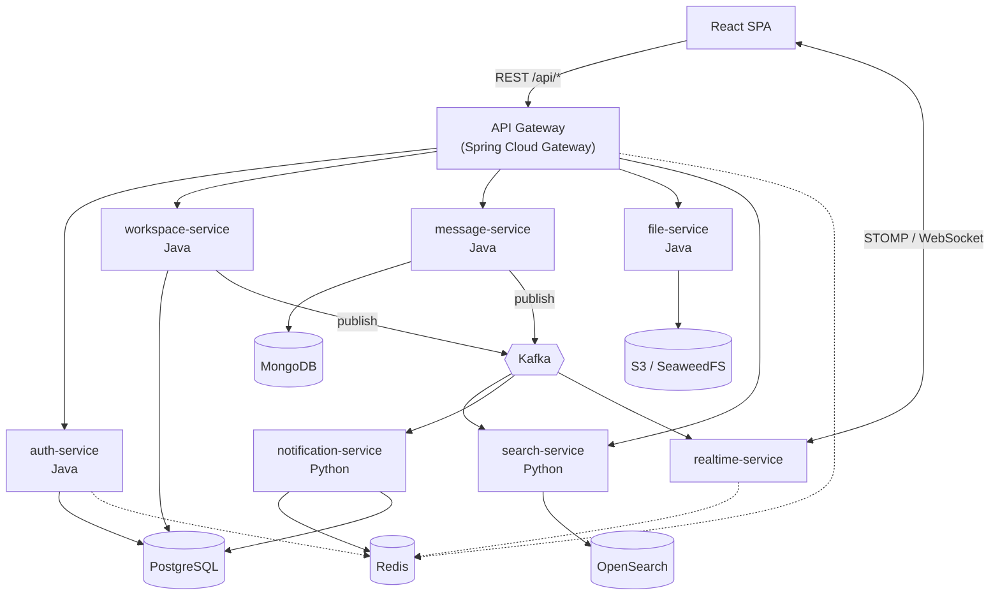

# Slack Clone

A team-chat application built the way a product team would actually build one: several
Spring Boot services, two Python services, Postgres and Mongo side by side, Kafka between
them, WebSockets for live delivery, and a React front end.

Everything runs locally with Docker. Nothing needs a cloud account.

- **Backend:** Java 17, Spring Boot 3.3, Spring Security, Spring Data JPA / Mongo, Spring Cloud Gateway
- **Python:** FastAPI (search indexer, notification fan-out)
- **Data:** PostgreSQL 16, MongoDB 7, Redis 7, OpenSearch 2, SeaweedFS (S3 API)
- **Messaging:** Kafka 3.8 (KRaft)
- **Front end:** React 18, TypeScript, Vite, Tailwind, STOMP over WebSocket
- **Ops:** Docker Compose, GitHub Actions, Prometheus/Grafana, Jaeger, Kubernetes manifests

---

## Quick start

Prerequisites: Docker Desktop (running), ~8 GB free RAM, ~10 GB disk. Nothing else —
Maven, the JDK, Node and Python all run inside containers.

```bash
git clone <your-remote> slack-clone
cd slack-clone

cp .env.example .env          # config lives in the environment, not in code

docker compose up -d          # infrastructure: Postgres, Mongo, Redis, Kafka, OpenSearch, S3, mail
docker compose ps             # wait until every row says (healthy) - roughly 60s on first boot
```

Then bring up the application services:

```bash
docker compose -f docker-compose.yml -f docker-compose.apps.yml up -d --build
```

Open <http://localhost:3000> and sign in:

| Email | Password | Role |
|---|---|---|
| `alice@acme.test` | `Password123!` | Owner |
| `bob@acme.test` | `Password123!` | Member |
| `carol@acme.test` | `Password123!` | Admin |
| `dave@partner.test` | `Password123!` | Guest (restricted) |

Open Alice in one browser and Bob in another to watch messages, typing indicators and
presence move in real time.

### Handy commands

```bash
docker compose logs -f auth-service      # follow one service
docker compose restart message-service   # restart one service, database untouched
docker compose down                      # stop everything, keep the data
docker compose down -v                   # stop and wipe the data (re-runs schema + seed)
```

`down -v` is how you reset to a clean slate. The Postgres schema, the seed data and the
Mongo index setup only run on an empty volume, so that's the only way to re-apply them.

### Ports

Two of these are shifted because your machine already has Postgres on 5432 and Mongo on
27017. Inside the Docker network the services still use the standard ports.

| What | URL / port | Notes |
|---|---|---|
| Front end | http://localhost:3000 | |
| API gateway | http://localhost:8080 | every API call goes through here |
| Swagger (auth) | http://localhost:8081/swagger-ui.html | each service exposes its own |
| Postgres | `localhost:5433` | user `slack_admin`, db `slackclone` |
| Mongo | `localhost:27018` | user `slack_app`, db `slackclone_messages` |
| Redis | `localhost:6379` | password in `.env` |
| Kafka | `localhost:29092` | external listener |
| OpenSearch | http://localhost:9200 | |
| S3 (SeaweedFS) | http://localhost:8333 | admin UI on 9333 |
| Search API | http://localhost:8000/docs | |
| Notifications | http://localhost:8001/docs | |
| Mail inbox | http://localhost:8025 | Mailpit - catches every outgoing email, relays none |
| Prometheus | http://localhost:9090 | targets at /targets, rules at /alerts |
| Grafana | http://localhost:3001 | `admin` / `admin`, dashboard provisioned from the repo |

---

## Architecture

### High level



### Why the pieces are split this way

**The gateway is the only public door.** Browsers never reach a service directly. The
gateway validates the JWT once, rate-limits, and forwards the caller's identity in
trusted headers. Services behind it don't each re-implement authentication.

**Realtime is its own service.** WebSocket connections are long-lived and stateful —
one socket per open tab, held for hours. That makes scaling rules completely different
from a stateless REST service: you scale on concurrent connections and memory, not on
CPU per request, and you can't roll a deploy without dropping sockets. Mixing that into
the REST services would force the worst of both worlds on all of them.

**Two databases, on purpose.** Users, workspaces and membership need foreign keys, unique
constraints and transactions — that's Postgres. Messages are append-heavy documents with
nested reactions, attachments and rich-text blocks; in SQL that's five joins to render one
message, and a migration every time a block type is added. That's Mongo. Using one store
for both means accepting the wrong trade-off somewhere.

**Kafka decouples the write path.** Posting a message updates Mongo, the search index,
unread counters, and every connected socket. If message-service called search and
notifications directly, then search being slow would make posting slow, and search being
down would make posting fail. Instead it publishes one event and returns. Consumers catch
up at their own pace, and a consumer that was down over the weekend replays from the log.

**Python for search and notifications.** Both are stream processors with no user-facing
API surface to speak of, and both are the kind of work where Python's ecosystem is
genuinely nicer (text handling, template rendering). They read the same Kafka topics as
everything else, so the language boundary costs nothing.

---

## Major decisions

The reasoning matters more than the choice — these are the ones worth being able to defend.

### Data

**UUID primary keys, not auto-increment.** Ids are minted in several services, so a
sequence would collide. Sequential integers also leak volume and let anyone walk your
data by counting upward. And a client can generate the id before the write, which makes
retries safe. Cost: 16 bytes instead of 8, and v4 has no time ordering so inserts scatter
through the B-tree. At much higher write volume the answer is UUIDv7.

**Unread state is a watermark, not a flag per message.** One `last_read_at` per
(user, channel). The obvious alternative — a row per user per message — is 500k rows for a
10k-message channel with 50 members, and "mark all read" becomes a bulk update of
thousands of rows. With a watermark, unread is one indexed count and marking read is one
row update. This is how Slack, WhatsApp and Discord all do it.

**Thread replies are separate documents.** Reactions and attachments are embedded in the
message (small, bounded, always read together). Replies are not — a thread can run to
hundreds, and embedding means rewriting the entire parent document on every reply, plus
eventually hitting Mongo's 16 MB cap. Replies are ordinary messages with a `threadRootId`.

**Transactional outbox for events.** A request has to commit a row *and* publish an event,
in two systems with no shared transaction. Commit-then-publish loses events; publish-then-commit
invents them. Retries don't fix it. So the event is written to an `outbox_events` row in
the same transaction as the business change, and a poller ships it to Kafka afterwards.
That gives at-least-once delivery, which is why every consumer dedupes on event id —
end-to-end exactly-once doesn't exist, and claiming otherwise in an interview is a tell.

**Denormalised counters where reads dominate.** `member_count` and `unread_count` are
derivable, but the sidebar renders them on every page load and N count queries per load
doesn't scale. The price is that they can drift, so they're updated in the same
transaction as the change that moves them.

### Security

**Short access token, rotating refresh token.** 15-minute access JWT, 7-day refresh token.
Refresh tokens live in Postgres rather than Redis: they're touched once per 15 minutes per
session, so speed is irrelevant, while durability and an audit trail are not.
Every refresh issues a new token and marks the old one replaced; if a replaced token is
presented again it was stolen, so the whole chain is revoked. That's OAuth 2.1 rotation
with reuse detection.

**Secrets are hashed, not just passwords.** Refresh tokens and invite tokens are stored as
SHA-256 hashes. If the database leaks, nothing in it can be replayed.

**Constraints in the database, not only in Java.** Two concurrent "accept invite" calls
both pass an application-level "already a member?" check and both insert. No amount of
service code prevents that race — only a unique constraint does, because it's checked
atomically. Validation in the app is for good error messages; the database is what makes
it true.

**Authorisation is per-workspace.** Role lives on `workspace_members`, not on `users`.
Someone can own their own workspace and be a guest in a client's. A global role column
makes that impossible.

**Unread counts are stored, not computed.** A sidebar of forty channels rendered by counting
messages newer than each watermark is forty queries against the message store, on every page
load, for every user. So `channel_members` carries `unread_count` and `unread_mention_count`,
maintained by workspace-service's `message.created` consumer — the service that owns the
table.

**Which forces a deduplication ledger.** Everything else in this system is made idempotent by
construction: "set `lastMessageAt` to X if X is newer" and "mark this membership inactive"
produce the same result however many times they run, so a redelivered event is harmless.
`unread_count = unread_count + 1` cannot be phrased that way. At-least-once delivery
guarantees the redelivery will happen — a rebalance, a redeploy mid-batch, a crash between
processing and the offset commit — and one of them makes the badge claim two messages where
there is one, which only reading the channel clears. `workspace.processed_events` records the
event id, claimed with `INSERT … ON CONFLICT DO NOTHING` inside the handler's own transaction
so the claim and the counters commit together. It is the only place in the system that needs
one, and the exception is worth understanding: reach for idempotency first, and a dedupe table
only when the operation genuinely cannot be repeated.

### Operations

**Hand-written schema, Flyway migrations, never `ddl-auto=update`.** Hibernate will add a
column but never safely rename, drop or backfill one, can't express partial indexes or
check constraints, and leaves you with whatever shape the entities happened to have. The
schema is reviewed like code.

**Health checks gate startup order.** "Container started" isn't "ready for connections."
Every dependency has a real readiness probe and services wait on it, instead of
crash-looping until the database wakes up.

**Config from the environment.** No credentials in code, no per-developer config files.
`.env.example` is committed so the variable list is discoverable; `.env` is not.

Longer write-ups live in `docs/` — HLD, LLD, the full schema walkthrough, the testing
strategy, the CI/CD pipeline, and how the work was broken into sprints.

---

## Testing

Four layers, each catching what the one below it cannot:

| Layer | Runs against | What it catches | How to run |
|---|---|---|---|
| Unit | One class, collaborators mocked | Logic and branch errors | `mvn test` |
| Integration (`*IT`) | One service + real Postgres/Mongo via Testcontainers | Wrong SQL, mapping bugs, transaction boundaries, constraint behaviour | `mvn verify` |
| Acceptance | The whole stack over the network | Wiring, config, HTTP contracts, cross-service behaviour | `bash scripts/verify/run-all.sh` |
| E2E | A real browser | Rendering, client state, realtime delivery | `bash e2e/run-in-docker.sh` |

Currently 118 unit and integration tests, 325 acceptance checks across ten suites, and 12
Playwright tests. Line coverage is gated at 70% per module by JaCoCo, so a module that drops
below it fails the build rather than quietly decaying.

The layer that earns its keep most often is the acceptance suite, because the bugs it finds
are the ones that live between services and in configuration - a Kafka producer whose
`delivery.timeout.ms` was below `linger.ms + request.timeout.ms`, an exception rolling back
the write it was meant to record, `crypto.randomUUID` being undefined outside a secure
context. None of those fail a unit test. `scripts/verify/README.md` has the full list and the
conventions that came out of it.

---

## Repo layout

```
backend/
  common-lib/          shared DTOs, error handling, JWT utils, event contracts
  api-gateway/         routing, JWT validation, rate limiting, CORS
  auth-service/        signup, login, token refresh, sessions      -> Postgres
  workspace-service/   workspaces, channels, membership, invites   -> Postgres
  message-service/     messages, threads, reactions, pins          -> Mongo
  realtime-service/    STOMP WebSocket, presence, typing           -> Redis pub/sub
python-services/
  search-service/      indexes Kafka events into OpenSearch, serves /search
frontend/              React + TypeScript SPA
infra/
  postgres/init/       schema + dev seed (first boot only)
  mongo/init/          collections, validators, indexes
  seaweedfs/           S3 credentials and bucket policy
  k8s/                 Kubernetes manifests
  prometheus/ grafana/ dashboards and scrape config
e2e/                   Playwright browser tests
scripts/verify/        black-box acceptance suites (see its README)
docs/                  architecture, schema, process, testing, CI/CD
.github/workflows/     CI and deployment pipelines
```

### What is built, and what is not

Worth stating plainly rather than leaving to be discovered:

| | State |
|---|---|
| auth, workspace, message, realtime, gateway, search, frontend | Running, tested, verified end to end |
| file-service (presigned uploads to SeaweedFS) | Not written. SeaweedFS is up and the bucket exists; nothing uses it yet |
| notification-service (email fan-out via Mailpit) | Running, tested, verified end to end |
| Prometheus + Grafana | Running. Every service scraped, one provisioned dashboard, seven alert rules |
| Jaeger / distributed tracing | Not wired up. Trace ids already flow through HTTP headers, MDC and Kafka headers, so the data is there - nothing collects it |
| Kubernetes manifests, CI/CD pipelines | Not written |

Known gaps inside what IS built:

- **Moderator delete.** Only an author can delete their own message. Removing abuse or a
  leaked credential from a channel you administer is not possible yet - it needs the
  caller's channel role, which message-service does not receive from workspace-service's
  internal endpoint.
- **A socket outliving its token.** An access token lasts 15 minutes; an open WebSocket is
  authorised once, on CONNECT. The client reconnects when it refreshes, so in practice the
  window closes - but the server does not currently force it.
- **No force-unsubscribe.** Removing someone from a channel stops new subscriptions; an
  already-open subscription keeps receiving until they reconnect.

---

## Troubleshooting

**A container sits at `(health: starting)` forever.** Check its logs:
`docker compose logs <service>`. OpenSearch is the usual suspect — it needs ~40s and will
refuse to start if `vm.max_map_count` is too low (Docker Desktop normally handles this).

**Port already in use.** Change the `*_HOST_PORT` value in `.env` and re-run
`docker compose up -d`. Only the host side moves; nothing inside the network changes.

**Schema or seed changes aren't showing up.** They only run on an empty volume.
`docker compose down -v` and start again.

**A service can't reach the database.** Inside a container, the database is `postgres`,
not `localhost` — `localhost` means that container. Host-side tools use `localhost:5433`.

**Auth suddenly fails everywhere after editing `.env`.** Changing `JWT_SECRET` invalidates
every issued token. Sign in again.
