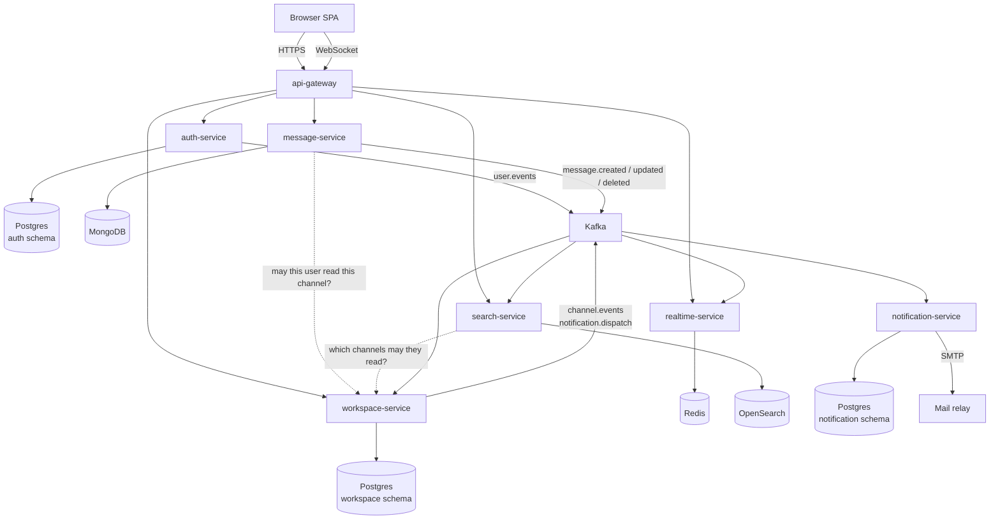
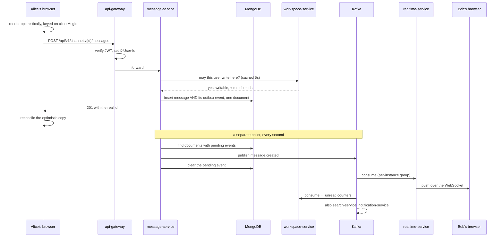

# High-level design

## What this is

A team chat application: workspaces containing channels, channels containing messages, messages
arriving on other people's screens as they are sent. The feature set is Slack's core — channels,
threads, direct messages, reactions, mentions, unread counts, search, presence, typing
indicators, email notifications.

The interesting part is not the feature list. It is that every one of those features has an
obvious implementation that works for ten users and fails for ten thousand, and the design
choices below are mostly about which failure each one avoids.

## The services, and why these boundaries

Seven services. The number is not the point — the boundaries are, and each one exists for a
reason that would still apply if the system were rewritten tomorrow.

### auth-service — identity, and nothing else

Owns accounts, passwords, sessions and tokens. Every other service verifies the tokens it
issues but none of them can mint one, which is the only boundary in the system that is about
blast radius rather than about coupling: a bug anywhere else cannot forge an identity.

It deliberately knows nothing about workspaces. A user is a user; whether they can read a
channel is somebody else's question.

### workspace-service — the authorisation authority

Owns workspaces, channels, membership and roles. It is therefore the only service that can
answer "may this user read this channel?", and two other services ask it on every request
through an internal endpoint.

That makes it the busiest service by request count even though its own API is quiet, and it is
the reason the answer is cached for five seconds in the callers (see
[02 — Low-level design](02-low-level-design.md)).

### message-service — the write-heavy one

Owns messages, threads, reactions and pins. Separated from workspace-service because the two
have completely different shapes: workspace data is small, highly relational and read far more
than written; message data is enormous, barely relational, append-mostly, and always queried the
same way — "the last fifty in this channel".

Those are different storage problems, and keeping them in one service means one database serving
both badly.

### realtime-service — the only stateful one

Holds the WebSocket connections. Separated because its scaling characteristic is unlike anything
else: it is bounded by the number of *open connections*, not by request rate, and a deploy
disconnects every client attached to the instance being replaced.

Mixing that into a stateless HTTP service means every deploy of any feature drops everyone's
socket.

### api-gateway — the single front door

Routing, token verification, rate limiting, CORS. Nothing else is exposed publicly, which is
what makes those controls meaningful: a service reachable directly has no rate limit at all.

### search-service (Python) — the read model

Consumes message events into OpenSearch and serves queries, filtered to the channels the caller
may read. Python because it is almost entirely IO-bound glue between a broker and a search
engine, and there is no domain model here for a type system to protect.

### notification-service (Python) — events into email

Consumes events and decides whether a human should be told. Almost all of its logic is about
**not** sending email: skip if the recipient is currently connected, skip if they were told
about this channel in the last five minutes, skip if they mentioned themselves, skip if this
event has already been handled. Sending the email is the easy part.

## How a message actually travels

Worth following precisely, because every design decision in the system shows up somewhere along
this path.

Five things in that diagram are deliberate and non-obvious.

**The optimistic render happens before the request.** The message appears instantly, keyed on a
client-generated `clientMsgId`, and is reconciled when the server replies with the real id. Chat
that waits for a round trip feels broken even when it is fast.

**The access check is a call, not a shared table.** message-service cannot read
workspace-service's tables — that is what a service boundary means — so it asks. Cached briefly,
and failing *closed*: if workspace-service is unreachable, the answer is no.

**The message and its event are one document write.** This is the transactional outbox, and it
is the single most important mechanic in the system. Mongo guarantees a single-document write is
atomic, so there is no state in which the message exists and the event that announces it does
not.

**The response is sent before the event is published.** Publishing takes up to a second;
the sender does not wait. Everything downstream — search, badges, email — is eventually
consistent by design, and the only consumer on the critical path of the sender's experience is
their own browser.

**realtime-service uses a per-instance consumer group.** Every instance receives every message,
because the clients that need it are spread across instances. This is the opposite of what every
other consumer wants, and getting it backwards produces a bug that does not reproduce on one
replica.

## The three storage choices

| | Holds | Why this store |
|---|---|---|
| Postgres | Users, workspaces, channels, membership, roles, invitations, notification ledger | Highly relational, needs real constraints. The uniqueness guarantees here are correctness, not optimisation: a unique index is the only thing that stops two concurrent requests both creating the same channel |
| MongoDB | Messages, threads, reactions, attachments | A message is a document with nested arrays of reactions and attachments, always read by channel and time. Modelling that relationally means three joins for every page of history. The flexible shape also matters: adding a field to a message is a code change, not a migration over a billion rows |
| Redis | Presence, typing, the access-check cache | All of it is ephemeral with a natural expiry. Presence is a key with a TTL rather than an online/offline flag, because nothing runs when a laptop lid closes — a flag would say "online" forever |

And one read model:

| | Holds | Why |
|---|---|---|
| OpenSearch | A copy of every message, analysed for search | A `LIKE '%term%'` scan over the message store is a full collection scan per query. Search is a fundamentally different access pattern from "the last fifty in this channel", so it gets its own store, kept in step by events |

### Schema-per-service, one Postgres instance

auth, workspace and notification each own a schema in one database. The isolation that matters —
nobody reads anybody else's tables — is identical to database-per-service, and one instance is
far less to run.

The cost is real and worth stating: they share a connection limit, a backup schedule, and a
failure domain. Splitting them later is a configuration change rather than a rewrite, precisely
because no query ever crosses a schema boundary.

## What the system guarantees, and what it does not

**At-least-once delivery, with idempotent consumers.** Every event will eventually arrive more
than once — a rebalance, a redeploy mid-batch, a crash between processing and the offset commit.
There is no configuration that makes this exactly-once end to end, and claiming otherwise is a
tell. Every consumer is therefore either naturally repeatable ("set this timestamp if newer") or
keyed on an event id ("increment this counter", "send this email").

**Eventual consistency everywhere except your own action.** You see your own message
immediately. Search, unread badges and email catch up within a second or two. That is a product
decision as much as a technical one: the alternative is making the sender wait for five
consumers.

**Read-your-writes within a service, not across them.** Posting a message then immediately
searching for it will not find it for a second or two. The UI never asks the user to care,
because nothing in the product requires it.

## Where this would break at scale

Honest limits, roughly in the order they would be hit:

- **The outbox poller is a one-second latency floor** and polls a table every second per
  service. The upgrade is change data capture (Debezium tailing the write-ahead log), which
  removes both the floor and the load.
- **No message partitioning.** One Mongo collection holds every message in the installation. The
  queries are all indexed by channel so this is fine for a long time, but eventually the answer
  is sharding on channel id.
- **realtime-service fan-out is per-instance.** Every instance consumes every message, so
  broker traffic grows with instances × message rate. A dedicated pub/sub tier is the next step.
- **The access check is a synchronous hop** on every message read. The cache makes it cheap, not
  free, and it couples message-service's availability to workspace-service's.
- **Search is one index with one shard.** Fine for tens of millions of messages, and the
  reindex-with-more-shards operation is a planned migration rather than a config change.

## What is not built

Named explicitly, because a design document that implies completeness is worse than one that
lists its gaps:

- **file-service.** SeaweedFS is running and the bucket exists; nothing uploads to it.
- **Distributed tracing.** Trace ids already flow through HTTP headers, MDC and Kafka headers,
  so the data exists — nothing collects it.
- **Moderator delete.** Only an author can delete their own message. Removing abuse from a
  channel you administer needs the caller's channel role, which message-service does not
  receive.
- **Forced unsubscribe.** Removing someone from a channel stops new subscriptions; an already
  open one keeps receiving until they reconnect.
